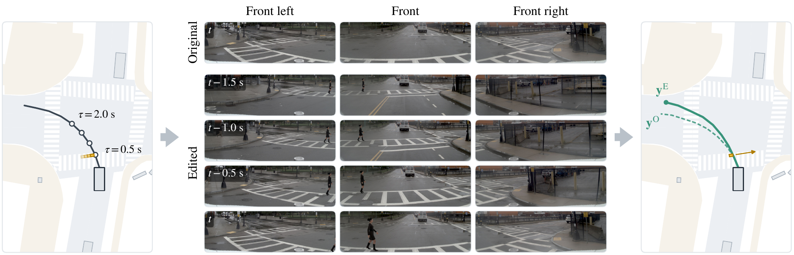

<h1 align="center">ReactBench-AD: Do Driving VLAs and World-Action Models React to Imminent Hazards in Their Path?</h1>

<p align="center">
  <a href="<arXiv link>">Paper</a>  | 
  <a href="<release link: ReactNAV>">Download</a>
</p>

<p align="center">
  
</p>

ReactBench-AD composites 3D assets into real NAVSIM (**ReactNAV**, 3,228 navtest samples) and PhysicalAI-Autonomous-Vehicles (**ReactPAI**, 1,045 clips) scenes along the ego vehicle's logged trajectory and measures the reaction of driving models by comparing the trajectories they predict for the original and edited scenes, isolating the causal effect of the inserted object.

## The benchmark

### Samples

ReactBench-AD has two parts: ReactNAV, built on NAVSIM navtest, and ReactPAI, built on PhysicalAI-AV. Each comes in
12 edited versions (runs), one per inserted object and look-ahead time τ, in folders named `<object>_tau<τ>s`: a
`crossing_pedestrian`, `standing_pedestrian` or `car` at τ = 0.5, 1.0, 1.5 or 2.0 s (e.g. `car_tau1.0s`). Inside a
run, each sample is a folder named by its NAVSIM token or PAI-AV clip ID, and its original scene is the unedited
sample with the same ID.

- **ReactNAV**: `final_images/<token>/{CAM_L0,CAM_F0,CAM_R0}/{0,1,2,3}.{png,jpg}`, the front-left, front and
  front-right cameras over four history frames 0.5 s apart (3 is the current frame). The ego history, velocity,
  acceleration and driving command are those of the NAVSIM navtest sample, available as
  `<outputs>/annotations/reactnav.json` (below), together with the paths of the original images.
- **ReactPAI**: `final_images/<clip>/<camera>/{0,1,2,3}.{png,jpg}` for `camera_cross_left_120fov`,
  `camera_front_wide_120fov`, `camera_cross_right_120fov` and `camera_front_tele_30fov`. The original images, the
  ego history (16 poses at 10 Hz) and the vehicle geometry come from the PAI-AV download;
  `reactbench.datasets.paiav.PAIAVCompactRun` loads them (`edited_camera_paths`, `materialize_original_images`,
  `ego_history`, `ego_vehicle_geometry`). There is no navigation command.
- Both: `metadata/<token>.json` describes the inserted object (asset, placement, motion); the scorer reads it.

### Scoring

The model predicts one trajectory for the original scene, y<sup>O</sup>, and one for the edited scene,
y<sup>E</sup>. Both are scored in the **edited** scene: y<sup>O</sup> is checked against the inserted object even
though the model never saw it, so it shows what would have happened had the model ignored the hazard, and the
difference between the two isolates the model's reaction. Every metric uses the first 4 s of the trajectory.

- **P**, the safety score: NC × DAC on ReactNAV (no at-fault collision, times drivable-area compliance) and NC on
  ReactPAI, which has no map for DAC. **ΔP** = P<sup>E</sup> − P<sup>O</sup>, in percentage points.
- **NC<sub>ins</sub>**: no at-fault collision with the inserted object, and its ΔNC<sub>ins</sub>.
- **CS**: the mean contact speed over the samples in which both trajectories collide at fault, and ΔCS in km/h. It
  catches reactions that slow down without avoiding the collision.
- **TIR**, the trajectory invariance rate: the percentage of samples whose original and edited trajectories differ
  by an ADE below ε = 0.05, 0.10, 0.20 and 0.50 m, pooled over τ. A high TIR means the model mostly ignores the
  object.

Collisions follow NAVSIM's at-fault rules, made slightly stricter (e.g. a lateral contact with a pedestrian or
cyclist is at fault), and are checked at 100 Hz along the piecewise-linearly interpolated trajectory. Each model is
scored on its own valid original/edited pairs, and all intervals are 95% percentile bootstrap intervals over scenes
with 10,000 resamples.

## Getting the data

**ReactNAV** is released; it builds on your copy of NAVSIM navtest (OpenScene logs, sensor blobs and maps).

1. Download the edited images (`<release link: ReactNAV>`, CC BY-NC-SA 4.0) to `datasets/reactnav/`. They are
   JPEGs saved with navtest's own settings (quality 80, 4:2:0).
2. Create your path settings from the template, `cp configs/paths.example.yaml configs/paths.yaml`, and set
   `navsim_data` in `configs/paths.yaml` to your NAVSIM data folder.
3. `python -m reactbench.datasets.navsim_annotations data/reactnav/reactnav.yaml` (NAVSIM devkit, e.g. the
   `recogdrive` environment of [Setup](#setup); writes `<outputs>/annotations/reactnav.json`).
4. `python -m reactbench.datasets.reactnav link`: the release holds only the frames the object changes; this adds
   the unchanged frames as links to your navtest images.
5. Download the lane polygons (`<release link: lanes>`) to `outputs/work/navsim/lanes/` (`scoring_work`); the
   ReactNAV scorer needs them. Regenerating them needs a NAVSIM v2 navtest metric cache:
   `python -m reactbench.scoring.navsim_lanes --tokens-from outputs/annotations/reactnav.json data/real_scenes/navtest_v2.json --metric-cache <cache>` with the NAVSIM v2 devkit on `PYTHONPATH`.

**ReactPAI** cannot be redistributed (PAI-AV licence) and is regenerated from the original clips:

1. Accept the dataset licence of `nvidia/PhysicalAI-Autonomous-Vehicles` on Hugging Face and `hf auth login`.
2. `python -m reactbench.datasets.download_reactpai` (`paiav_root` in `configs/paths.yaml`) downloads only the
   1,045 clips' cameras, LiDAR, egomotion, calibration and obstacle labels (about 470 GB, against ~10 TB for the
   whole archives); `--dry-run` previews it.
3. Composite the 12 runs as in [Building the benchmark](#building-the-benchmark).

## Evaluating your model

1. Save one prediction per sample for the original scenes and the 12 runs, as
   `<outputs>/predictions/<model>/<reactnav|reactpai>/<original|run>/trajectories/<token>.npz` with `trajectory`,
   an (N, 3) float array of rear-axle poses (x forward, y left, heading in radians) in the ego frame at the current
   frame, pose i at time (i + 1) · dt, and `interval_length_s` = dt. It must cover at least 4 s; the first 4 s are
   scored. The original and the edited prediction of a sample should use the same random numbers. The six runners in
   `reactbench/models/` are worked examples: subclassing `reactbench.models.runner.Runner` gives the run layout,
   paired seeds, failure handling and scoring (`models/drivewam/eval.py` is about 50 lines).
2. Score them (CPU; Python with the NAVSIM devkit for ReactNAV, `scoring_python` in `configs/paths.yaml`):

   ```bash
   python -m reactbench.scoring outputs/predictions/<model>/reactnav [--workers 8]
   python -m reactbench.scoring outputs/predictions/<model>/reactpai
   ```

   Each run gets `metrics/*_at_fault_{per_sample,summary,manifest}.json`.
3. Summarize:

   ```bash
   python -m reactbench.summarize --models <model> --tables main tir [--by-speed]
   ```

   prints P, NC<sub>ins</sub> and CS with their edit effects and intervals for every object and τ, and the TIR per
   object, and writes them to `<outputs>/summaries/`. `--by-speed` also writes ΔP by ego speed as CSV.

## Running the evaluated models

### Setup

1. `third_party/setup.sh` fetches Alpamayo 1.5, Alpamayo 2, AutoVLA, DriveWAM and SimWAM at the evaluated commits,
   applies `third_party/patches/` and installs Blender 4.5.11 LTS for [Building the benchmark](#building-the-benchmark)
   (`--no-blender` skips it). ReCogDrive and its NAVSIM devkit are in `third_party/recogdrive` (`CHANGES.md`).
2. Environments (`conda env create -f envs/<name>.yml`; the Alpamayo ones are uv environments, see the head of
   `envs/alpamayo*.txt`):

   | Environment                    | Used for                                                                    |
   | ------------------------------ | --------------------------------------------------------------------------- |
   | `recogdrive`                 | ReCogDrive, scoring (`scoring_python`), NAVSIM annotations                |
   | `autovla`                    | AutoVLA; PAI-AV compositing (`PYTHON=` for `scripts/composite_paiav.sh`) |
   | `compositing-navsim`         | NAVSIM compositing (`PYTHON=` for `scripts/composite_navsim.sh`), assets |
   | `pctnet`                     | PCTNet harmonization (`PCTNET_PYTHON=`)                                    |
   | `drivewam`, `simwam`       | DriveWAM, SimWAM                                                            |
   | `alpamayo1_5`, `alpamayo2` | Alpamayo 1.5, Alpamayo 2                                                    |

   Run commands from the repository root with `PYTHONPATH=third_party/recogdrive:.` (`scripts/env.sh`).
3. `configs/paths.yaml`: the NAVSIM data, `paiav_root`, checkpoints, outputs and `scoring_python` (any key can
   also be set as `REACTBENCH_<KEY>`).
4. `scripts/download_checkpoints.sh` downloads ReCogDrive, AutoVLA, DriveWAM and SimWAM (then run
   `python -m reactbench.models.simwam.prompt_embedding` in the `simwam` environment). The Alpamayo models load from
   the Hugging Face cache (accept their licences and log in). The ReCogDrive IL + RT checkpoint
   (`<release link: checkpoint>`) goes to `checkpoints/recogdrive/IL_RT/recogdrive_il_rt.ckpt`.

### Evaluation

Every runner takes a benchmark run, first caches the original-scene predictions (`--original`, once per model and
dataset), then predicts and scores each run; outputs go to `<outputs>/predictions/<model>/<dataset>/<run>/`. Each
runs in its model's environment, after the ReactNAV annotations of [Getting the data](#getting-the-data).

```bash
for model in recogdrive drivewam autovla simwam alpamayo1_5 alpamayo2; do             # ReactNAV
  python -m reactbench.models.$model.eval datasets/reactnav/car_tau0.5s --original
  for run in datasets/reactnav/{crossing_pedestrian,standing_pedestrian,car}_tau*; do
    python -m reactbench.models.$model.eval $run
  done
done
for model in alpamayo1_5 alpamayo2; do                                                # ReactPAI
  python -m reactbench.models.$model.eval datasets/reactpai/car_tau0.5s --dataset reactpai --original
  for run in datasets/reactpai/*_tau*; do python -m reactbench.models.$model.eval $run --dataset reactpai; done
done
```

`--config` selects a configuration, each with its own `--original` pass: ReCogDrive `rl` (default), `il`, `vlm_sft`
and `il_rt` (IL fine-tuned on ReactTrain); SimWAM `rl` (default) and `il`; AutoVLA `config` (default) and `l0r0`.
`--max-samples N` runs a smoke test, `--overwrite` replaces an existing output. GPU numerics differ slightly between
GPU models; the paper's runs used NVIDIA A100 and H100 GPUs.

AutoVLA reads its own preprocessed navtest samples (`autovla_inputs`: AutoVLA's `run_nuplan_preprocessing.sh` on
navtest, without CoT). As in AutoVLA's released code, its front-left and front-right views are CAM_L1/R1, which are
not rendered: they stay original, and the runner skips the 1, 4 and 9 crossing-pedestrian samples (τ = 1.0, 1.5,
2.0 s) whose pedestrian would enter them (`data/reactnav/autovla_side_camera_fov.json`). `--config l0r0`
(`autovla_l0r0`) feeds the rendered CAM_L0/R0 instead, on every sample.

## Building the benchmark

This needs Blender (`third_party/setup.sh`), the `compositing-navsim` (ReactNAV) or `autovla` (ReactPAI) and the
`pctnet` environments of [Setup](#setup), and GPUs for rendering and harmonization.

```bash
scripts/download_checkpoints.sh depth                  # Depth Anything V2 Small, run offline by both compositors
scripts/assets.sh humans <Microsoft-Rocketbox clone>   # Rocketbox 0943055
scripts/assets.sh cars <openx-assets clone>            # OpenX 463ea3d
for tau in 0.5 1.0 1.5 2.0; do                         # runs <object>_tau<tau>s, e.g. car_tau1.0s
  scripts/composite_navsim.sh $tau                     # ReactNAV: crossing pedestrian
  scripts/composite_navsim.sh --standing $tau
  scripts/composite_navsim.sh --car $tau
  scripts/composite_paiav.sh $tau                      # ReactPAI
  scripts/composite_paiav.sh --standing $tau
  scripts/composite_paiav.sh --car $tau
done
```

The scenes and crossing sides are fixed by `data/`: ReactNAV is the 3,228 navtest scenes with an ego speed of at
least 5 km/h (all end up at 5-40 km/h) in which all three objects can be placed at every look-ahead time and every
run rendered successfully; the selection scripts are
not released. The ReactPAI clips are listed in `data/reactpai/selection_manifest.json`.

## Citation

```bibtex
<BibTeX>
```

## Licences and acknowledgements

The code is Apache-2.0 (`LICENSE`). The modified ReCogDrive copy in `third_party/recogdrive` (changes in
`CHANGES.md`) and the libcom subset in `reactbench/compositing/harmonization` keep their Apache-2.0 licences. The
evaluated models, Blender and the pretrained weights are fetched from their publishers (`third_party/setup.sh`,
`scripts/download_checkpoints.sh`) under their own licences.

ReactNAV, the lane polygons and the files in `data/reactnav/`, `data/reacttrain/` and `data/real_scenes/` are
derived from nuPlan, OpenScene and NAVSIM and are released under CC BY-NC-SA 4.0, the licence of those datasets.
ReactPAI is not redistributed: `data/reactpai/` and `data/knockout/` hold only PAI-AV clip identifiers and, for
ReactPAI, the PAI-AV files each clip is read from and its crossing side.

The pedestrians and animals are built from Microsoft Rocketbox avatars (MIT,
`reactbench/assets/rocketbox/ROCKETBOX_LICENSE.md`). The seven cars are OpenX Assets adaptations of CC BY 4.0
Sketchfab models: Audi TT Roadster (2014), Dacia Duster (2010), Hyundai Tucson (2015) and Mini Countryman (2016) by
razor24; BMW X1 (2016) by mk2design; Volvo EX30 (2024) by Mehdi Lagzouli (LagzDesign); and Volvo V60 Polestar
(2013) by myedsu. The PAI-AV hood mask is derived from "Mercedes-Benz GLS (X167) 2019" by Merc_TV (CC BY 4.0).

<Acknowledgements>
